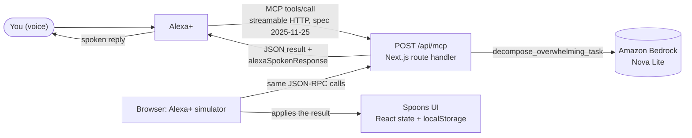

<div align="center">

# Spoons × Alexa+

### Tell Alexa+ how much energy you have. Spoons plans your day around it.

**A calm, neuro-inclusive planner built on Spoon Theory, with a voice layer powered by an MCP server, Alexa+, and Amazon Bedrock.**


[Quick Start](#quick-start) · [Try the Simulator](#try-the-simulator) · [Alexa+ Voice Layer](#alexa-voice-layer) · [API Reference](#api-reference) · [Report a Bug](https://github.com/RadhaRaniBasak/spoons-alexa-plus/issues)

<!-- Add a screenshot or GIF of the app and the Alexa+ simulator here, for example:
 -->

</div>

---

## Table of Contents

- [Overview](#overview)
- [What Is Spoon Theory?](#what-is-spoon-theory)
- [Features](#features)
- [Quick Start](#quick-start)
- [Try the Simulator](#try-the-simulator)
- [Alexa+ Voice Layer](#alexa-voice-layer)
- [Configuration](#configuration)
- [API Reference](#api-reference)
- [How Spoons Plans Your Day](#how-spoons-plans-your-day)
- [Project Structure](#project-structure)
- [Tech Stack](#tech-stack)
- [Deployment](#deployment)
- [Privacy](#privacy)
- [Troubleshooting](#troubleshooting)
- [Known Limitations](#known-limitations)
- [Roadmap](#roadmap)
- [Contributing](#contributing)
- [Acknowledgements](#acknowledgements)
- [License](#license)

---

## Overview

Most productivity tools assume you wake up with the same energy every day. A to-do list doesn't know you slept badly, are in pain, or spent yesterday masking at work. It just grows, and when you can't keep up, it makes you feel like you failed.

**Spoons starts from energy, not time.** You set a daily budget of spoons, every task costs some of them, and the app recommends only what fits what you have left. It is built for people whose capacity changes from day to day, including people with chronic illness, ADHD, autism, long COVID, burnout, and caregivers.

**This repo adds a voice layer.** An MCP server (`POST /api/mcp`) exposes seven tools that Alexa+ can call, so you can simply say how you slept or how you feel:

> “Alexa, I slept 5 hours, I'm overwhelmed, and I need to study for GATE, reply to Prof Nair, and cook dinner.”

Spoons logs the sleep, recalibrates your budget, drops to a gentler pace, defers heavy tasks, turns on the brown-noise shield, and turns the rest of the sentence into spoon-costed tasks. A built-in **Alexa+ simulator** lets you try the whole flow in the browser, with no Echo device required.

## What Is Spoon Theory?

Spoon Theory was created by **Christine Miserandino** in 2003 to explain what living with chronic illness feels like. Each "spoon" is one unit of energy. Everyday activities such as getting dressed, cooking, commuting, and socializing each cost spoons, and when they're gone, they're gone. Borrowing from tomorrow is possible, but it has a price. Spoons turns that metaphor into a planning tool.

## Features

### Energy-first planning

| Feature | What it does |
|---|---|
| **Daily spoon budget** | A budget of 0–12 spoons. Every task costs 1–4, and remaining spoons drive everything else in the app. |
| **Four paces** | **Full Pace**, **Balanced**, **Quiet Dusk**, and **Rest Mode**. They are derived automatically from your remaining spoons and can be overridden in Settings. |
| **Smart plate** | Active tasks are ranked by how well they fit your remaining energy, your current context (desk, mobile, physical, low-brain), and how hard they are to start. See [How Spoons Plans Your Day](#how-spoons-plans-your-day). |
| **Overdraft guardrail** | Tasks that exceed your remaining spoons are flagged as borrowed energy. "Borrowed from tomorrow" is capped at 3 spoons. |
| **Guilt-free triage** | Tasks live in **Active**, **Later**, **Done**, **Archived**, or **Rest**. Nothing is "overdue". |
| **Task tiers** | Full, medium, and survival versions of a task. For example, a walk becomes an "Easy 10-min stroll outside". |
| **Ignition prompt and micro-steps** | Every task has a roughly 30-second starting action and three one-spoon micro-steps. |
| **Quick Start flow timer** | A 5-minute, no-commitment timer to get past the hardest part: starting. |
| **Brain dump** | Write or say several chores in one sentence and get separate tasks, each with a spoon cost, friction level, and context. |
| **Baseline living and spoon thieves** | Track the daily basics (wake-up, water and essentials, freshen up, breakfast) and the drains that quietly cost energy (sensory noise, physical fatigue, long meetings). |
| **Rest rituals** | 2-Min Eye Rest, Hydration & Stretch, Warm Sound Bath, and Pause for Tomorrow, each worth 1–2 spoons. |
| **Mood calendar** | A monthly calendar with hand-drawn mood faces (blue, green, yellow) for pressure-free reflection. |

### Alexa+ voice layer

| Feature | What it does |
|---|---|
| **MCP server** | `POST /api/mcp` implements MCP spec `2025-11-25` with 7 tools for Alexa+. |
| **Alexa+ simulator** | In-app panel with text input, a microphone button (browser speech recognition), six preset utterances, spoken replies (browser speech synthesis), and a live JSON-RPC inspector. |
| **Amazon Bedrock micro-steps** | `decompose_overwhelming_task` asks Amazon Nova Lite to slice an intimidating task into three one-spoon steps. It is optional and falls back to a static template without AWS credentials. |

### Sensory and focus support

| Feature | What it does |
|---|---|
| **380 Hz brown-noise shield** | Synthesized live in the browser with the Web Audio API. No audio files, and volume is adjustable. |
| **Quiet Dusk mode** | A dimmed, low-stimulation interface for low-energy moments. |
| **Font choice** | Atkinson Hyperlegible (default), Plus Jakarta Sans, or monospace. |
| **Focus reading highlights** | Optional saccadic-style anchoring that emphasizes the start of words. |
| **Device preview** | Switch between a web layout, a single phone frame, and a phone showcase. |

## Quick Start

### Requirements

- **Node.js 20.9 or later** (required by Next.js 16)
- npm (or yarn / pnpm)
- Internet access for Google Fonts
- *Optional:* an AWS account with Amazon Bedrock access, for AI micro-steps (see [Configuration](#configuration))

### Install and run

```bash
# 1. Clone the repository
git clone https://github.com/RadhaRaniBasak/spoons-alexa-plus.git
cd spoons-alexa-plus

# 2. Install dependencies
npm install

# 3. Start the dev server
npm run dev
```

Open **http://localhost:3000**. No API keys or environment variables are needed to run the app locally.

### Scripts

| Command | Description |
|---|---|
| `npm run dev` | Start the dev server with hot reload |
| `npm run build` | Create an optimized production build |
| `npm run start` | Serve the production build (run `build` first) |
| `npm run lint` | Not usable yet: Next.js 16 removed `next lint` (see [Troubleshooting](#troubleshooting)) |

## Try the Simulator

1. Run `npm run dev` and open http://localhost:3000.
2. Find the **Spoons • Alexa+ Multimodal Simulator** panel on the main page.
3. Click a preset, type a sentence, or press **Speak** and say it.
4. Watch three things update together: the Alexa+ reply (also read aloud), the live JSON-RPC inspector showing the request and response, and your Spoons board.

### Preset utterances

| Preset | MCP tool called |
|---|---|
| 😴 “Alexa, I only slept 4h 15m, calibrate my day” | `log_sleep_and_calibrate` |
| 🎧 “Alexa, turn on 380Hz sensory shield” | `trigger_sensory_shield` |
| 🎙️ “Alexa, I'm down to 2 spoons, rebalance” | `rebalance_schedule` |
| 🧠 “Alexa, brain dump chores & log breakfast” | `voice_brain_dump` |
| ⚡ “Alexa, break down portfolio task (Bedrock)” | `decompose_overwhelming_task` |
| ⏱️ “Alexa, body double with me for 5m” | `start_body_double` |

### Say anything

Anything you type or speak in the free-text box goes to `plan_from_any_utterance`, which pulls out sleep, energy, task limits, and the tasks themselves. Try:

- **“Alexa, I slept 5 hours, I'm overwhelmed, and I need to study for GATE, reply to Prof Nair, and cook dinner”**
  Logs 5 hours of sleep (daily budget becomes 6), drops you to 3 spoons remaining at Quiet Dusk pace, starts the brown-noise shield, caps your plate at 3 light tasks, and adds your three tasks.
- **“Alexa, I have 2 spoons left, clear my board”**
  Sets your remaining energy to 2 spoons and keeps only your 2 lightest tasks on the plate; the rest move to Later.
- **“Alexa, schedule only 2 tasks today”**
  Keeps your 2 lightest tasks and defers the rest.

The [parsing rules](#plan_from_any_utterance-parsing-rules) are listed below.

## Alexa+ Voice Layer

### How it fits together



Each tool returns structured data plus a ready-to-speak `alexaSpokenResponse`. Alexa+ handles the language understanding and decides when to call a tool; this server decides what the tool does. In the simulator, the browser makes the same JSON-RPC calls Alexa+ would, then applies the results to the on-screen board.

### The seven tools

| Tool | Required input | What the server returns | What the simulator does with it |
|---|---|---|---|
| `plan_from_any_utterance` | `utterance` | Parsed signals (sleep hours, spoons, task cap, overwhelm, clear-board, brown-noise flag), the leftover task text, and a spoken reply | Applies the full plan: budget, pace, brown noise, task cap, new tasks, and deferrals |
| `log_sleep_and_calibrate` | `hoursSlept` | `sleepMinutes`, `calibratedDailyBudget`, and a spoken reply | Logs sleep and sets the daily budget |
| `trigger_sensory_shield` | `triggerType` | `brownNoise: "ACTIVATE_380HZ"`, `energyMode: "survival"`, and a spoken reply | Starts the 380 Hz shield, switches to Quiet Dusk, and counts one "sensory noise" drain |
| `voice_brain_dump` | `rawUtterance` | A spoken reply | Splits the sentence into spoon-costed tasks on your board. The demo also checks off the morning basics and bumps the nutrition tile |
| `rebalance_schedule` | `remainingSpoons`, `sensoryState` | A spoken reply | Drops to Quiet Dusk and defers heavy tasks to Later |
| `decompose_overwhelming_task` | `taskTitle` | Three one-spoon `microSteps` and the `engine` name | Replaces the micro-steps of the demo portfolio task |
| `start_body_double` | none (`taskId` and `durationMinutes` optional) | `status: "FLOW_TIMER_STARTED"`, `durationMinutes: 5` | Starts the 5-minute Quick Start timer |

### `plan_from_any_utterance` parsing rules

The parser is rule-based (regular expressions, English only) and understands digits or number words.

| Signal | Examples it recognizes | Effect |
|---|---|---|
| **Sleep** | “slept 5 hours”, “sleep for only six hrs” (numbers or one–ten) | Logs sleep and sets the budget: under 6 h → 6 spoons, 7.5 h or more → 11, otherwise 9 |
| **Spoons** | “3 spoons”, “two spoons” | Sets how many spoons you have remaining |
| **Task cap** | “keep only 3 tasks”, “schedule 2 tasks”, “just one task”, “3 tasks only” | Caps the plate at that many tasks (numbers or one–five) |
| **Overwhelm** | tired, exhausted, overwhelmed, drained, anxious, migraine, headache, burnout, sick, unwell, loud, sensory, “low energy”, “no energy”, “not feeling okay” | Switches to Quiet Dusk, sets remaining energy to 3 spoons (unless you gave a number), caps the plate at 3 |
| **Clear the board** | “clear my board”, “clear everything”, “defer”, “move rest”, or any task cap or overwhelm signal | Keeps your lightest tasks (2 by default) and moves the rest to Later |
| **Sensory shield** | loud, noise, sensory, overwhelmed, migraine, headache, shield | Starts the 380 Hz brown noise |
| **Everything else** | “study for GATE, reply to Prof Nair, and cook dinner” | Split into separate tasks, each with an estimated spoon cost, context, and starting action |

Tip: phrase feelings as “I'm overwhelmed” or “I'm exhausted”. A phrase like “I feel overwhelmed” isn't stripped from the sentence and can show up as a task (see [Known Limitations](#known-limitations)).

### Connect to a real Alexa+ device

Alexa+ acts as an MCP client and supports MCP spec `2025-11-25` over streamable HTTP, which is the version this server reports. To use your server with Alexa+, you create an **Alexa+ MCP add-on** that points at it:

1. [Deploy this app](#deployment) so that `https://<your-domain>/api/mcp` is publicly reachable over HTTPS. For quick tests from your laptop, expose port 3000 with a tunnel such as ngrok or Cloudflare Tunnel.
2. Confirm the server is up: `curl https://<your-domain>/api/mcp` should return `"status":"online"`.
3. Follow Amazon's guide to create an MCP add-on, using your `/api/mcp` URL as the server endpoint: [Alexa+ MCP Toolkit overview](https://developer.amazon.com/docs/alexaplus/add-ons/mcp-toolkit-overview.html).
4. Deploy the add-on with the Alexa AI CLI, test it in the Alexa+ web simulator, then on an Alexa device.
5. If you change tools, redeploy the add-on with `alexa-ai deploy` so Alexa+ picks them up.

This repo ships the MCP server, not the add-on configuration. Read [Known Limitations](#known-limitations) before going beyond a demo.

## Configuration

Everything works without configuration. Add AWS credentials only if you want real Amazon Bedrock micro-steps from `decompose_overwhelming_task`.

Create `.env.local` in the project root (`.env*` files are already in `.gitignore`):

```bash
AWS_ACCESS_KEY_ID=your-access-key-id
AWS_SECRET_ACCESS_KEY=your-secret-access-key
# AWS_SESSION_TOKEN=...   # only needed for temporary credentials
AWS_REGION=us-east-1
```

| Variable | Required | Default | Purpose |
|---|---|---|---|
| `AWS_ACCESS_KEY_ID` | No | none | With the secret key, enables Bedrock for `decompose_overwhelming_task` |
| `AWS_SECRET_ACCESS_KEY` | No | none | See above. Both keys must be set to enable Bedrock |
| `AWS_SESSION_TOKEN` | No | none | Needed only when using temporary credentials |
| `AWS_REGION` | No | `us-east-1` | Region for the Bedrock Runtime client |

**Bedrock details.** The tool calls the Converse API with the model ID `us.amazon.nova-lite-v1:0`. Make sure that model is available to your account and region, and that your IAM identity is allowed to invoke it (`bedrock:InvokeModel`). If credentials are missing or the call fails, the tool silently falls back to a static three-step template, so the demo never breaks.

## API Reference

### MCP endpoint: `/api/mcp`

| | |
|---|---|
| **Transport** | HTTP `POST`, JSON-RPC 2.0 request and response bodies |
| **Protocol version** | `2025-11-25` |
| **Server info** | `spoons-alexa-plus-mcp` v`2.3.0` |
| **Methods** | `initialize`, `tools/list`, `tools/call` |
| **Unknown methods or tools** | JSON-RPC error `-32601` (`Method not found`) |
| **`GET /api/mcp`** | Health check returning status, protocol version, endpoint, and tool names |

Tool results arrive in `result.content[0].text` as a **JSON string**. Parse it to read the fields.

```bash
# Health check
curl http://localhost:3000/api/mcp

# List tools
curl -X POST http://localhost:3000/api/mcp \
  -H "Content-Type: application/json" \
  -d '{"jsonrpc":"2.0","id":1,"method":"tools/list"}'

# Call a tool
curl -X POST http://localhost:3000/api/mcp \
  -H "Content-Type: application/json" \
  -d '{
    "jsonrpc": "2.0",
    "id": 2,
    "method": "tools/call",
    "params": {
      "name": "log_sleep_and_calibrate",
      "arguments": { "hoursSlept": 4.25 }
    }
  }'
```

Response (the inner `text` is a JSON string):

```json
{
  "jsonrpc": "2.0",
  "id": 2,
  "result": {
    "content": [
      {
        "type": "text",
        "text": "{\"tool\":\"log_sleep_and_calibrate\",\"sleepMinutes\":255,\"calibratedDailyBudget\":6,\"alexaSpokenResponse\":\"I logged 4.25 hours of sleep in Spoons. Since you're running on sleep debt, I calibrated your daily budget to 6 spoons and paced your schedule for recovery.\"}"
      }
    ]
  }
}
```

A `plan_from_any_utterance` call looks like this, and returns the parsed signals:

```bash
curl -X POST http://localhost:3000/api/mcp \
  -H "Content-Type: application/json" \
  -d '{"jsonrpc":"2.0","id":3,"method":"tools/call","params":{"name":"plan_from_any_utterance","arguments":{"utterance":"Alexa, I slept 5 hours, keep only 3 tasks, and I need to study for GATE, reply to Prof Nair, and cook dinner"}}}'
```

Parsed result (formatted for readability):

```json
{
  "tool": "plan_from_any_utterance",
  "detectedSleepHours": 5,
  "explicitSpoons": null,
  "maxTasks": 3,
  "clearBoard": true,
  "isOverwhelmed": false,
  "activateBrownNoise": false,
  "taskSegmentText": "and I need to study for GATE, reply to Prof Nair, and cook dinner",
  "alexaSpokenResponse": "I heard you. I logged 5 hours of sleep, cleared your board and scheduled only your 3 lightest tasks for today. Take your time and rest."
}
```

### Task helper: `POST /api/deconstruct`

A plain REST endpoint that breaks tasks down without any AI call. It is deterministic and always available. (The current UI does not call it yet, but it is ready for other clients.)

| Field | Type | Description |
|---|---|---|
| `mode` | `"slice"` or `"braindump"` | `slice` turns one task into an ignition prompt and three micro-steps. `braindump` splits a sentence into several tasks |
| `input` | string | The task or sentence. An empty value returns `400` |

```bash
curl -X POST http://localhost:3000/api/deconstruct \
  -H "Content-Type: application/json" \
  -d '{"mode":"braindump","input":"reply to Prof Nair and then clean my desk, plus study for GATE"}'
```

Returns `{ "source": "deterministic-fallback", "tasks": [...] }`. For that input the tasks are:

| Task | Spoons | Context | Status |
|---|---|---|---|
| Reply to Prof Nair | 1 | mobile | plate |
| Clean my desk | 2 | physical | plate |
| Study for GATE | 3 | desk | holding |

The sentence is split on “and then”, “and also”, “also”, “then”, “plus”, “and”, commas, semicolons, and new lines. Each piece is scored by keyword: deep-work verbs (study, write, build, debug…) cost 3 spoons at a desk, quick messages (email, reply, call…) cost 1 on mobile, physical chores (clean, wash, buy…) cost 2, and low-brain tasks (read, review, check…) cost 1. The first two tasks go on the plate and the rest wait in Later.

`slice` mode (`{"mode":"slice","input":"Reply to Prof Nair"}`) returns `ignitionPrompt` and `microSteps`, with tailored templates for messages and email, code and bug fixes, and cleaning, plus a generic template for everything else.

## How Spoons Plans Your Day

### Paces

Your pace follows your remaining spoons (daily budget minus spent), unless you override it in Settings.

| Remaining spoons | Pace | `energyMode` | Active tasks shown |
|---|---|---|---|
| 9 or more | Full Pace | `high` | Up to 5 |
| 4 to 8 | Balanced | `balanced` | Up to 3, preferring tasks that cost 3 spoons or less |
| 1 to 3 | Quiet Dusk | `survival` | Up to 2, lightest and lowest-friction first |
| 0 | Rest Mode | `recharge` | None. Rest rituals instead |

### Task ranking

Each active task gets a compatibility score, and the highest scores are shown first:

```
fatigueFactor    = 1 + spent / dailyBudget
capacityTerm     = 3.5 × (remaining − spoonCost)
inertiaBonus     = +4.0 if the task's context matches your current context
frictionPenalty  = 2.5 × (activationFriction × fatigueFactor)
overdraftPenalty = 1.5 × max(0, spoonCost − remaining)²

score = capacityTerm + inertiaBonus − frictionPenalty − overdraftPenalty
```

The later in the day it gets, the more hard-to-start tasks are penalized, because `fatigueFactor` grows as you spend spoons.

### Data model

| Field | Values | Meaning |
|---|---|---|
| `spoonCost` | 1–4 | Energy the task costs |
| `activationFriction` | 1–3 | 1 easy to start, 2 moderate, 3 "wall of awful" |
| `inertia` | `desk`, `mobile`, `physical`, `low-brain` | The context the task needs |
| `status` | `plate`, `holding`, `completed`, `composted` | Shown as Active, Later, Done, Archived |
| `ignitionPrompt` | string | A starting action that takes about 30 seconds |
| `microSteps` | list | One-spoon slices of the task |
| `isBorrowedEnergy` | boolean | The task goes beyond today's remaining budget |

Types live in [`types/spoons.ts`](types/spoons.ts). The running app keeps its own copy of the same types inside `app/page.tsx`.

## Project Structure

```
spoons-alexa-plus/
├── app/
│   ├── api/
│   │   ├── mcp/route.ts           # MCP server: 7 Alexa+ tools (JSON-RPC over HTTP)
│   │   └── deconstruct/route.ts   # Deterministic task slicer and brain-dump splitter
│   ├── globals.css                # Tailwind directives and per-pace theme tokens
│   ├── layout.tsx                 # Root layout and Google Fonts
│   └── page.tsx                   # The app: UI, planning logic, brown noise, built-in Alexa+ simulator
├── components/
│   └── AlexaPlusSimulator.tsx     # Standalone simulator component (not used by page.tsx yet)
├── lib/
│   ├── brownNoise.ts              # Standalone 380 Hz brown-noise engine
│   └── ranking.ts                 # Standalone copy of the task-ranking logic
├── store/
│   └── useSpoonStore.ts           # Zustand store, persisted as "spoons-v2-storage" (not wired into the page yet)
├── types/
│   └── spoons.ts                  # Shared TypeScript types
├── postcss.config.js              # PostCSS: enables Tailwind
├── tailwind.config.js             # Tailwind content paths
├── LICENSE
├── package.json
└── tsconfig.json
```

The running app is self-contained in `app/page.tsx`. The standalone modules in `components/`, `lib/`, and `store/` are a modular version of the same logic, ready to be wired in as the code is split up.

## Tech Stack

| Layer | Technology |
|---|---|
| Framework | [Next.js 16](https://nextjs.org/) (App Router, Turbopack) |
| UI | [React 19](https://react.dev/) |
| Language | [TypeScript 5](https://www.typescriptlang.org/) |
| Styling | [Tailwind CSS 3](https://tailwindcss.com/) and CSS variables |
| Icons | [Lucide React](https://lucide.dev/) |
| Alexa+ integration | [Model Context Protocol](https://modelcontextprotocol.io/) (JSON-RPC 2.0 over HTTP), spec `2025-11-25` |
| AI | [Amazon Bedrock](https://aws.amazon.com/bedrock/) Runtime (Converse API) with Amazon Nova Lite |
| Voice | Web Speech API (speech recognition and speech synthesis) |
| Audio | Web Audio API (procedural brown noise) |
| State | React state, persisted to `localStorage` under the key `spoons-v2-storage` |

`zustand` (used only by the standalone store), `framer-motion`, and `@modelcontextprotocol/sdk` are declared in `package.json` but not used by the running app yet.

## Deployment

Any host that runs Next.js 16 works, for example Vercel or AWS Amplify Hosting.

1. Push the repository to GitHub and import it into your host.
2. Set the build command to `npm run build` and the start command to `npm run start` (most hosts detect these automatically).
3. *(Optional)* Add the [environment variables](#configuration) in the host's dashboard to enable Bedrock.
4. Deploy, then verify `GET https://<your-domain>/api/mcp` returns `"status":"online"`.
5. To connect Alexa+, continue with [Connect to a real Alexa+ device](#connect-to-a-real-alexa-device).

Before exposing the MCP endpoint beyond a demo, add authentication to it (see [Known Limitations](#known-limitations)).

## Privacy

- Your board, budget, settings, and mood calendar are stored **in your browser** (`localStorage`). Clearing site data resets the app.
- Text you send to Alexa+ through the simulator is posted to `/api/mcp`. The server does not store it.
- When Bedrock is enabled, only the task title you ask to break down is sent to Amazon Bedrock.
- Depending on your browser, speech recognition may send audio to a cloud service. Typing always works as an equal alternative.

Spoons is a planning and pacing tool inspired by Spoon Theory. It does not diagnose, treat, or monitor any condition and is not a substitute for professional care. "Neuro-inclusive" describes how the interface is designed around executive-function and sensory needs; the app does not read brain activity.

## Troubleshooting

**The UI looks unstyled, or the console says `Unknown at rule @tailwind`.**
Tailwind needs two config files in the project root. Create them if they are missing:

```js
// tailwind.config.js
/** @type {import('tailwindcss').Config} */
module.exports = {
  content: ['./app/**/*.{ts,tsx}', './components/**/*.{ts,tsx}'],
  theme: { extend: {} },
  plugins: [],
};
```

```js
// postcss.config.js
module.exports = { plugins: { tailwindcss: {} } };
```

**`npm run build` fails with `Cannot find module '@/types/spoons'`.**
In `tsconfig.json`, the `@/*` path alias must point at the project root, because there is no `src/` folder:

```json
"paths": { "@/*": ["./*"] }
```

**`npm run lint` fails with `Invalid project directory provided`.**
Next.js 16 removed the `next lint` command. Run ESLint directly once you add an ESLint config.

**The Speak button says speech recognition isn't supported, or the microphone is blocked.**
Use Chrome or Safari, and allow microphone access for `localhost` in your browser's address bar. On macOS Safari, turn on Dictation in System Settings → Keyboard.

**No sound from the brown-noise shield.**
Browsers only start audio after a click or tap. Press the brown-noise control (or any simulator preset) once, then check your volume slider in Settings.

**"Amazon Bedrock Nova Lite" appears in the result, but I haven't set any credentials.**
That is the fallback template. See [Known Limitations](#known-limitations). Add [AWS credentials](#configuration) to get real Bedrock output.

**Port 3000 is already in use.**
Run `npm run dev -- -p 3001`.

**I want a clean slate.**
Open your browser's DevTools → Application → Local Storage, and delete the `spoons-v2-storage` key. Then reload.

## Known Limitations

This is a working demo, and these are the gaps to know about:

- **No shared state.** The MCP server is stateless, and your board lives in the browser. The simulator applies tool results on-screen, but a real Alexa+ call returns only a spoken reply and cannot yet change your board. Syncing real devices needs shared storage and user accounts.
- **Minimal MCP surface.** The server implements `initialize`, `tools/list`, and `tools/call`, and answers with plain JSON rather than an event stream. It does not handle notifications (such as `notifications/initialized`) or `ping`, and most tool calls sent without `arguments` return a server error (HTTP 500). Check Amazon's add-on requirements when you connect a real device.
- **No authentication.** `/api/mcp` and `/api/deconstruct` are open. Add auth before exposing them publicly.
- **Rule-based language understanding.** Parsing is English-only and keyword-driven. Phrases like “I feel overwhelmed” aren't stripped from the task text, and the example in the simulator's text-box placeholder can leave a stray task behind. Use “I'm overwhelmed” for clean results.
- **Bedrock labeling.** `decompose_overwhelming_task` reports `engine: "Amazon Bedrock Nova Lite"` even when it used the static fallback template, and the simulator badge always reads “Amazon Bedrock Active”.
- **Some inputs are accepted but not applied yet.** These are `sleepQuality`, `taskId`, and `durationMinutes` (the timer is always 5 minutes), plus `remainingSpoons` from `rebalance_schedule` in the simulator. Spoken replies are templated; for example, the sleep reply always mentions sleep debt.
- **Accessibility is a goal, not a certification.** The reduced-motion setting exists in the data model but is not applied yet, and WCAG conformance is not claimed.

## Roadmap

Planned next, from the original Spoons roadmap:

**Executive-function support**

- **Pick one for me**: one tap dims every other card and opens Quick Start for the best-fitting task
- **Transition bridge**: a calm 60-second reset card when the next task is in a different context
- **Voice capture**: microphone input in the main capture bar (it already works inside the Alexa+ simulator)

**Sensory and time awareness**

- **Sound profiles**: warm brown, soft pink, and an optional binaural theta pulse
- **Time-horizon arc**: rings that show how much of the day remains
- **Breath pacer**: an optional 4-7-8 breathing circle inside Quick Start

**Guilt-free continuity**

- **Calendar day inspector**: tap a date to see that day's sleep, completed tasks, and pace
- **Wrap up today**: one tap moves unfinished tasks to Later with a reassuring summary

## Contributing

Ideas and feedback are welcome.

1. Fork the repository
2. Create a branch: `git checkout -b feature/your-feature`
3. Commit your changes: `git commit -m "Add your feature"`
4. Push the branch: `git push origin feature/your-feature`
5. Open a Pull Request

Found a bug? [Open an issue](https://github.com/RadhaRaniBasak/spoons-alexa-plus/issues).

## Acknowledgements

- **Christine Miserandino**, creator of [Spoon Theory](https://butyoudontlooksick.com/articles/written-by-christine/the-spoon-theory/)
- The chronic illness, disability, and neurodivergent communities who keep this metaphor alive
- Amazon's [Alexa+ MCP Toolkit](https://developer.amazon.com/docs/alexaplus/add-ons/mcp-toolkit-overview.html), Amazon Bedrock, and Amazon Nova
- The maintainers of Next.js, React, Tailwind CSS, and Lucide

## License

Released under the **MIT License**. See [`LICENSE`](LICENSE). Copyright © 2026 Radharani Basak.

*Made with care, for every kind of energy.*
